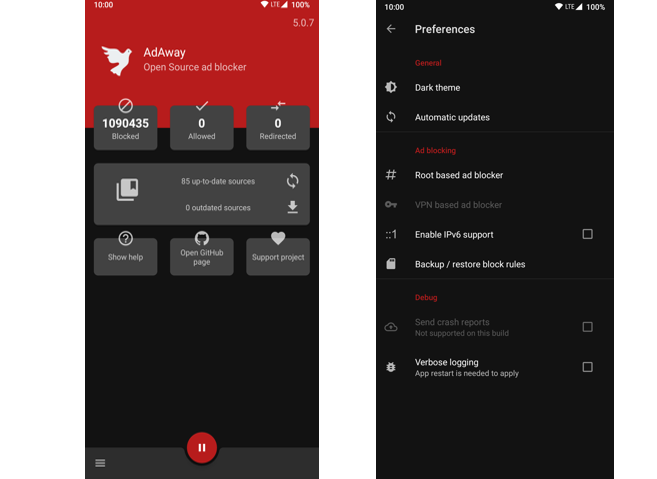

# AdAway Nedir? Android İçin Açık Kaynaklı ve Güçlü Reklam Engelleyici

Akıllı telefonlarımızda web sitelerinde gezinirken, oyun oynarken veya uygulamaları kullanırken karşımıza çıkan rahatsız edici reklamlar ve gizliliğimizi tehdit eden izleyiciler (trackers) dijital deneyimi oldukça olumsuz etkiliyor. Tarayıcı tabanlı reklam engelleyiciler bir yere kadar çözüm sunsa da tüm uygulama ve oyunlardaki reklamları engellemek için sistem genelinde çalışan profesyonel bir araca ihtiyaç duyulur. 

İşte tam bu noktada, Android dünyasının en köklü ve güvenilir açık kaynaklı projelerinden biri olan **AdAway** devreye giriyor. Peki **AdAway nedir**, root'lu ve root'suz cihazlarda nasıl çalışır? Bu kapsamlı rehberde detayları inceliyoruz.

---

## AdAway Nedir ve Nasıl Çalışır?

**AdAway**, Android işletim sistemi için geliştirilmiş tamamen ücretsiz ve açık kaynaklı (FOSS) bir sistem geneli reklam engelleme uygulamasıdır. Tarayıcılarda eklenti olarak çalışmak yerine doğrudan cihazınızın ağ trafiğini filtreleyerek tarayıcılarda, oyunlarda ve uygulamalardaki reklamları kaynağında durdurur.

AdAway, cihazınızın root durumuna bağlı olarak iki farklı akıllı çalışma modu sunar:

### 1. Root'lu Cihazlar İçin (Hosts Dosyası Yöntemi)
Eğer cihazınızda root yetkisi varsa AdAway, sistemin **hosts** dosyasını günceller. Reklam ve izleyici sunucularının alan adlarını (hostname) yerel IP adresi olan `127.0.0.1` adresine yönlendirir. Reklam yüklenmek istendiğinde istek hiçbir yere varamaz ve böylece reklam alanları hiç yüklenmez.

### 2. Root'suz Cihazlar İçin (Yerel VPN Yöntemi)
Cihazınızda root yoksa endişelenmeyin! AdAway, cihaz içerisinde yerel bir **VPN (Virtual Private Network)** hizmeti çalıştırarak ağ isteklerini denetler. Reklam ve izleyici sunucularına giden bağlantıları anında tespit eder ve engeller. Bu sayede root gerekmeden tüm sistemde reklamsız bir deneyim elde edersiniz.

---

## AdAway'in Öne Çıkan Temel Özellikleri

* **Sistem Geneli Engelleme:** Sadece internet tarayıcınızda değil, telefonunuzdaki tüm uygulama ve oyunlarda reklamlardan kurtulursunuz.
* **Önceden Tanımlanmış Listeler:** Uygulama içinden güvenilir reklam ve izleyici engelleme listelerini (host files) kolayca indirebilir ve güncelleyebilirsiniz.
* **Özel İzin ve Engellenen Listeler (Whitelist / Blacklist):** Kendi ana bilgisayar (host) kurallarınızı ekleyebilir, belirli sitelerin veya uygulamaların engellemesini esnetebilirsiniz.
* **Yerel Web Sunucusu Seçeneği:** Engellenen host adlarına yanıt vermek ve istekleri dilediğiniz yerel IP adresine yönlendirmek için dahili web sunucusunu aktifleştirebilirsiniz.
* **Uygulama Hariç Tutma:** VPN modundayken, VPN süzgecinden muaf tutmak istediğiniz belirli uygulamaları kolayca seçebilirsiniz.

---

## AdAway Neden Tercih Edilmeli?

 
 

1. **Tamamen Açık Kaynaklı ve Şeffaf:** Gizliliğinizi tehlikeye atacak arka kapılar barındırmaz. Kodları topluluk tarafından denetlenir.
2. **Pil ve Veri Tasarrufu:** Yüklenmeyen reklamlar ve engellenen arka plan izleyicileri sayesinde mobil veri kullanımınız azalır ve pil ömrünüz uzar.
3. **Esneklik:** İster root'lu ister root'suz olsun, her modern Android cihazda sorunsuz çalışır.

---

## Sonuç

AdAway, Android'de reklamsız, hızlı ve gizlilik odaklı bir dijital yaşam isteyenler için vazgeçilmez bir açık kaynaklı araçtır. Tarayıcı reklamlarından sıkıldıysanız ve telefonunuzun kontrolünü tamamen elinize almak istiyorsanız AdAway tam size göre.

---
